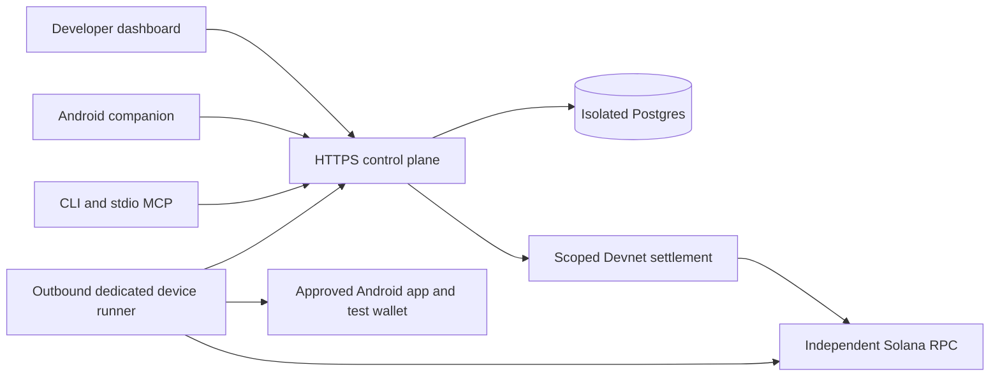

# Architecture

The control plane owns users, projects, builds, jobs, events, device registrations, leases, reports and evidence access. Public discovery returns approved capability fields and never includes a USB serial. Providers initiate outbound connections and hold a scoped credential. A job grant binds the runner, device, run, expiry and build digest. Device operations are gated by a reviewed catalog on the host. A separate service identity and database keep customer workloads outside the financial application.

Device and runner observations are claims. A valid Ed25519 signature authenticates the issuer and bound evidence. Positive financial acceptance requires independent RPC evidence for the approved cluster, exact expected effects and commitment. Chain and attestation evidence have separate status fields. A funding intent and a payout intent reference separate signatures and reconcile before any retry decision.

Scripted MWA tests preserve the migrated Localnet path independently of hosted device operation. Agent runs present bounded observations and named actions. The agent chooses actions and deterministic checks assign outcomes. The provider app monitors sessions while the dedicated desktop runner owns approved ADB. A consumer phone and its personal profile remain outside the platform boundary.

The imported Android engine, test Java fixture, chain assertions and release proof are the compatibility baseline. The old financial escrow, production user tables and unrelated integrations stay in the source repository. The release workflow pattern, independent chain checks and reconciliation state lessons carry forward. [Migration record](docs/migration/UPSTREAM.md) · [Source reuse audit](docs/mobile-test/REUSE.md) · [API](services/control-plane/API.md)
